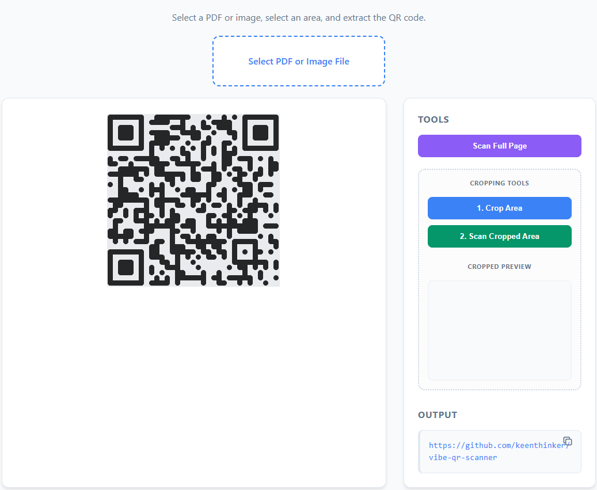

### 🕵️‍♂️ Offline QR Code Reader for documents (Public Sector Edition)
A lightweight, **100% privacy-compliant** tool to extract QR codes from PDF documents and images - completely offline and without the need for installation.



### 🌟 Why this tool?
In restrictive IT environments (such as government agencies), hardware scanners or permission to use online tools are often missing. This project uses only the browser to process QR codes locally. No data ever leaves your computer.

### 🛠 Features
- PDF support: loads multi-page PDFs (via PDF.js).
- Image support: processes PNG, JPG, etc.
- Smart scan: automatically detects QR codes anywhere on the page.
- Vibe-Coded UI: manual cropping functionality for difficult-to-read or cluttered documents.
- Zero-Footprint: no database, no backend, no cloud.
- Portable Structure: everything is pre-configured and packed into a single file, so you can just copy the folder and run it.

### 🚀 Installation & launch
Because modern browsers block the loading of scripts from the local hard drive (the `file://` protocol) for security reasons, there are two ways to start the tool:

#### Option A: via a web server (recommended)
Simply upload the files to an internal web server. You can then access the tool normally via its URL.

#### Option B: local launch without a server (The "Public Sector hack")
If you need to launch the `vibe-qr-scanner.html` directly from your desktop, the browser will block certain functions. Here is how to bypass this:

##### For Windows (Chrome or Edge):
1. Create a shortcut of Google Chrome or Microsoft Edge on your desktop.
2. Right-click the shortcut and select `Properties`.
3. In the target field, add the following at the very end (after the quotation marks): `--allow-file-access-from-files`
4. Click OK to save.
5. Drag and drop the `vibe-qr-scanner.html` into this browser window.

##### Alternative: launch via terminal (Windows)
If you prefer the command line, you can start Chrome/Edge directly with the required flag. Open your terminal (PowerShell or CMD) and run:

###### For Google Chrome
`"C:\Program Files (x86)\Google\Chrome\Application\chrome.exe" --allow-file-access-from-files "C:\path\to\your\vibe-qr-scanner.html"`

###### For Microsoft Edge
`"C:\Program Files (x86)\Microsoft\Edge\Application\msedge.exe" --allow-file-access-from-files "C:\path\to\your\vibe-qr-scanner.html"`

##### For Firefox:
1. Type `about:config` into the address bar.
2. Search for `security.fileuri.strict_origin_policy`.
3. Set the value to `false`.

#### 🏗 Tech Stack
- Vanilla JS (ES6 modules)
- PDF.js for rendering.
- Nimiq QR-Scanner for detection.
- Custom CSS Styling.

### 📜 Legacy Version (Maximum Compatibility)
For environments with older browser versions or stricter security policies that prevent ES6 module loading, I have included a legacy version in the `/legacy` folder.

**Key Differences:**

- **No ES6 Modules**: Uses UMD and .js instead of .mjs.
- **PDF.js v3.x**: Utilizes the classic JavaScript version of the library.
- **Improved Compatibility**: Works on older browsers that do not support modern module syntax or `type="module"`.

If the main version doesn't load or throws syntax errors, try the `/legacy/vibe-qr-scanner.html`.

## 📂 Repository structure

The project is organized to be as portable as possible. Each version is designed as a "Single-File-Solution" regarding the core logic and styling:

```text
.
├── vibe-qr-scanner.html    # Version in German (modern ES6 modules / .mjs)
├── vibe-qr-scanner-en.html # Version in English
├── js/                     # Local libraries (PDF.js & Nimiq QR-Scanner)
    └── pdf.min.mjs         # Mozilla PDF.js library
    └── pdf.worker.min.mjs  # PDF.js worker
    └── qr-scanner.min.js   # Nimiq QR Code scanner library
    └── qr-scanner-worker.min.js   # Nimiq QR Code scanner worker
├── legacy/
    └── vibe-qr-scanner.html    # Legacy version (UMD / PDF.js v3.x - for older browsers)
    └── js/
        └── pdf.min.js                  # Mozilla PDF.js v3.11.x library
        └── pdf.worker.min.js           # PDF.js worker
        └── qr-scanner.umd.min.js       # Nimiq QR Code scanner UMD library
        └── qr-scanner-worker.min.js    # Nimiq QR Code scanner worker
```